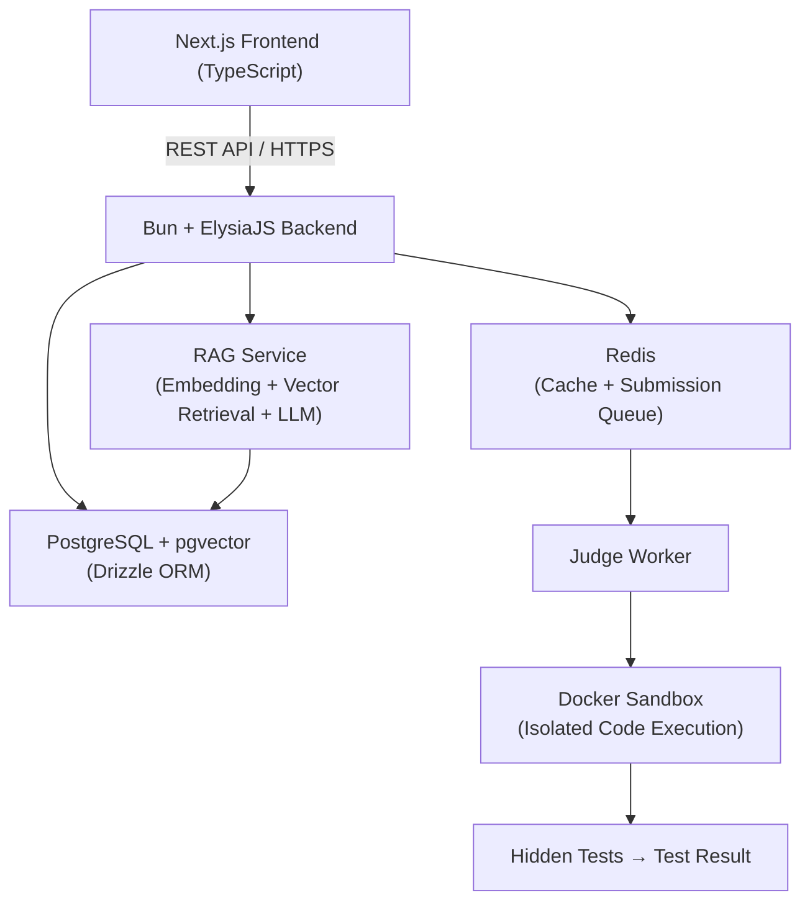

# LurnKode — AI-Assisted Learning Platform with Evidence-Based Tutoring and Automated Code Assessment

> **CO3103 · HK261** | Môn: Cloud Programming  
> **Nhóm 6 thành viên** | Timeline: Tuần 39–49

**LurnKode** là một Learning Management System (LMS) dành cho lập trình viên, tích hợp các thành phần AI và đánh giá tự động:

- 📚 **Core LMS** — Quản lý khóa học, tiến độ học, thảo luận, thông báo
- 🤖 **AI Tutor có căn cứ (RAG)** — Trả lời dựa trên học liệu khóa học, trích nguồn rõ ràng
- 📝 **Đánh giá MCQ & Lập trình** — Chấm điểm tự động, lịch sử làm bài, kết quả học viên
- ⚙️ **Judge Worker tự động** — Hàng chờ nộp bài → Docker Sandbox → Hidden Tests → Kết quả
- 🛡️ **Giám sát tính liêm chính** — Ghi nhận sự kiện bất thường, Instructor review

---

## 🏗️ Kiến trúc Hệ thống



**Luồng chính:**
```
Next.js Frontend
      |
      | REST API
      v
Bun + ElysiaJS
      |
      +-------------------+
      |                   |
      v                   v
PostgreSQL + pgvector    Redis
      |                   |
      v                   v
RAG Service         Submission Queue
(Retrieval + LLM)         |
                          v
                    Judge Worker
                          |
                          v
                    Docker Sandbox
                          |
                          v
                    Hidden Tests → Result
```

**Ranh giới kiến trúc quan trọng:**
- Next.js là lớp UI — không chứa business logic
- Bun + ElysiaJS là lớp REST API — không truy cập DB trực tiếp từ frontend
- PostgreSQL là data store chính; pgvector xử lý vector/embedding
- Redis quản lý cache và hàng chờ bài nộp
- RAG Service xử lý truy vấn AI từ học liệu đã được publish
- Judge Worker chạy riêng biệt, code học viên chỉ chạy bên trong Docker Sandbox
- Submitted code là untrusted code — **tuyệt đối không chạy trực tiếp trong API process**

---

## 🧱 Tech Stack

| Layer | Technology | Ghi chú |
|---|---|---|
| **Frontend** | Next.js + TypeScript | App Router, SSR, file-based routing |
| **Backend** | Bun + ElysiaJS | TypeScript, Eden type sharing FE–BE |
| **API** | REST API | Primary FE–BE integration |
| **Database** | PostgreSQL | Primary relational data store |
| **ORM** | Drizzle ORM | Type-safe schema, migrations |
| **Vector Search** | pgvector | HNSW index, cosine similarity, RAG |
| **Cache / Queue** | Redis | Caching + submission queue |
| **AI** | LLM + Embeddings + RAG | Course-grounded evidence-based tutor |
| **Code Execution** | Docker Sandbox | Isolated, resource-limited sandbox |
| **Deployment** | Docker + CI/CD | GitHub Actions, feature branch workflow |

---

## 🎯 Phạm vi Chức năng (MVP)

### Learning Management
| Module | Mô tả |
|---|---|
| **Auth & RBAC** | Learner / Instructor / Admin, JWT |
| **Course Management** | Tạo/sửa/publish, Chapter → Lesson → Material |
| **Enrollment & Progress** | Enroll, mark completed, resume, % tiến độ |
| **Discussions** | Thảo luận trong khóa học |
| **Notifications** | Thông báo hệ thống |

### Assessment
| Module | Mô tả |
|---|---|
| **MCQ** | Câu hỏi trắc nghiệm, auto grading |
| **Programming Exercises** | Bài tập lập trình, auto judge |
| **Automated Grading** | Chấm điểm tự động qua hidden tests |
| **Attempt History** | Lịch sử làm bài |
| **Integrity Monitoring** | Ghi nhận sự kiện bất thường cho Instructor review |

### Administration
| Module | Mô tả |
|---|---|
| **User Management** | Quản lý tài khoản |
| **Course Management** | Quản trị khóa học |
| **Basic Reporting** | Báo cáo cơ bản |
| **Integrity Event Review** | Instructor xem xét sự kiện gian lận |

### AI Tutor (RAG)
```
Published Course Material
      ↓ Chunking & Embedding
pgvector → Vector Retrieval → Relevant Context
      ↓
LLM → Answer + Source Citation
```
- Chỉ sử dụng học liệu đã được publish làm nguồn kiến thức
- Câu hỏi ngoài phạm vi → **không hallucinate**, trả về thông báo rõ ràng
- Mỗi câu trả lời kèm citation đủ để học viên quay lại bài học
- Học viên có thể feedback helpful/unhelpful

### Code Judge
```
Code Submission
      ↓
Submission Queue (Redis)
      ↓
Judge Worker
      ↓
Docker Sandbox (1 CPU · 128MB RAM · 3s Timeout)
      ↓
Hidden Tests
      ↓
Result: AC / WA / TLE / RTE
```

> ⚠️ **Out of MVP scope**: Payment processing, Live streaming

---

## 📊 Data Model (High-Level)

```
Learning Domain:
User
 └── Enrollment
       └── Course
             └── Chapter
                   └── Lesson
                         └── Material
                               └── RAGSource

Assessment Domain:
Course
 └── Assessment
       └── AssessmentItem (MCQ / Programming)

User
 └── Attempt
       └── Answer
       └── CodeSubmission
             └── TestResult

AI / Operations:
User
 └── AIConversation
       └── AIMessage
             └── Citation

User └── Notification
User / Admin └── AuditLog
```

---

## 🏛️ Kiến trúc Phát triển

| Component | Vai trò |
|---|---|
| **Frontend** (`apps/web`) | Next.js UI — gọi REST API, không chứa business logic |
| **API** (`apps/api`) | Bun + ElysiaJS — xử lý request, validation, RBAC |
| **Database** | PostgreSQL + Drizzle ORM — schema, migrations, queries |
| **Redis** | Cache API responses + Submission Queue |
| **RAG Service** | Embed course material, vector search, LLM generation |
| **Judge Worker** | Nhận job từ Redis Queue, gọi Docker Sandbox |
| **Docker Sandbox** | Chạy code học viên bị cô lập, enforce resource limits |

---

## 📅 Timeline (Tuần 39–49)

| Tuần | Nội dung |
|---|---|
| **39** | Requirements, proposal, kiến trúc |
| **40** | Database schema, API contracts, UI/UX spec |
| **41** | Auth, RBAC, user management |
| **42** | Course, chapter, lesson, material |
| **43** | Enrollment, learning progress, learning flow |
| **44** | Question bank, assessment, submission |
| **45** | RAG pipeline, document processing, indexing |
| **46** | AI Assistant, citation, out-of-scope handling |
| **47** | Random exam, auto grading, integrity detection |
| **48** | Integration, testing, evaluation, bug fixing |
| **49** | Benchmark, documentation, demo, final report |

**Thứ tự ưu tiên**: Core LMS → Assessment → RAG AI → Integrity → Integration & Eval

---

## 👥 Team (6 thành viên)

| Vai trò | Trách nhiệm |
|---|---|
| **Tech Lead / Backend / Security** | Architecture, API design, Auth, RBAC, Security |
| **Course & Learning** | Course management, enrollment, progress, learning flow |
| **Assessment** | Question bank, exam generation, submission, grading |
| **AI / RAG** | Chunking, embeddings, retrieval, LLM, citation, eval |
| **Frontend / UX** | Learner/Instructor UI, AI chat, dashboard, responsive |
| **Integrity / QA / DevOps** | Integrity monitoring, audit log, testing, CI/CD, deployment |

---

## ⚡ Performance Targets

| Metric | Target |
|---|---|
| API response (p95) | < 500ms |
| Code execution (Judge) | < 3s |
| RAG query latency | < 3s |
| Frontend LCP | < 2.5s |
| Test coverage | ≥ 80% |

---

## ✅ Quality Gates

- **Test coverage ≥ 80%** — enforced trong GitHub Actions CI
- **Code review** bắt buộc trước khi merge (feature branch workflow)
- **No secrets in git** — `.env` không commit, dùng GitHub Secrets
- **PostgreSQL RLS** trên tất cả tables
- **CORS strict** — origin whitelist, không dùng `*` ở production

---

## ⚠️ Known Risks

| Risk | Mitigation |
|---|---|
| AI hallucination | RAG + retrieval threshold + citation bắt buộc + out-of-scope handler |
| Grading sai | Instructor override + human review |
| False positive integrity flag | Warning only, không tự kết luận; instructor review evidence |
| Scope quá lớn cho 6 người | Prioritize Must-Have trước; Advanced features sau |
| LLM cost / latency | Cache embedding, pre-index, top-k retrieval, avoid unnecessary LLM calls |

---

## 📁 Docs

| File | Mô tả |
|---|---|
| [DEVELOPER_GUIDE.md](./DEVELOPER_GUIDE.md) | **Hướng dẫn toàn diện cho lập trình viên (Setup, Docker, Kiến trúc, API & Kiểm thử)** |
| [`docs/guides/tech-stack.md`](./docs/guides/tech-stack.md) | Kiến trúc chi tiết, stack decisions, LLM options |
| [`docs/guides/getting-started.md`](./docs/guides/getting-started.md) | Setup môi trường dev từ đầu |
| [`docs/guides/environment-setup.md`](./docs/guides/environment-setup.md) | Cấu hình `.env` cho mọi môi trường |
| [`docs/README.md`](./docs/README.md) | Mục lục đầy đủ docs |
| [`.agents/skill-manifest.md`](./.agents/skill-manifest.md) | Danh sách skills AI agent + maintenance |
