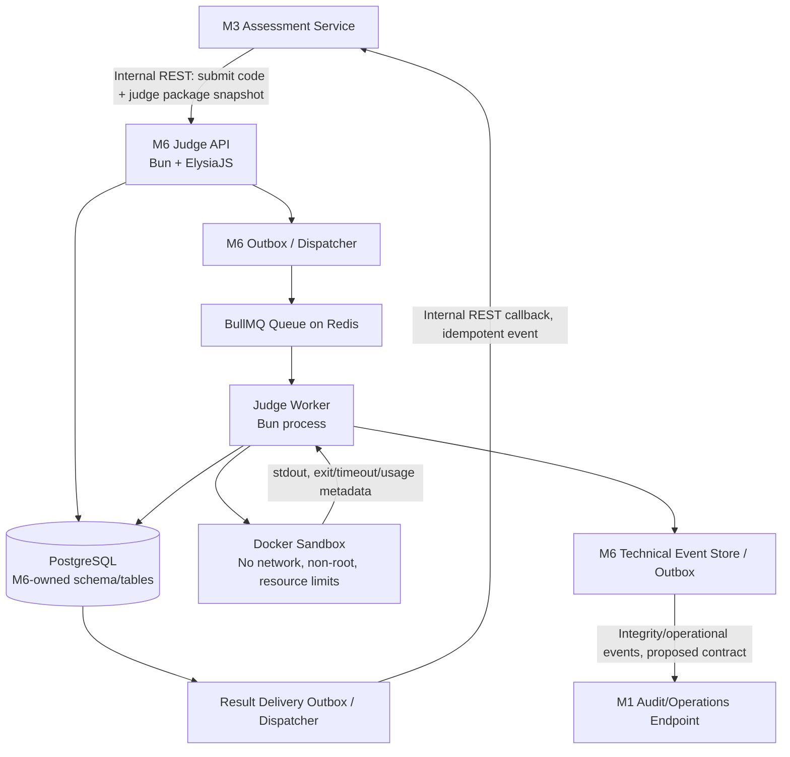
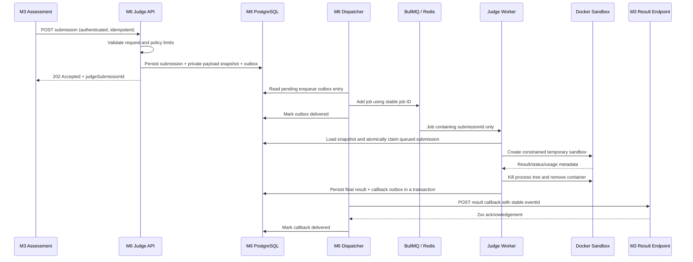
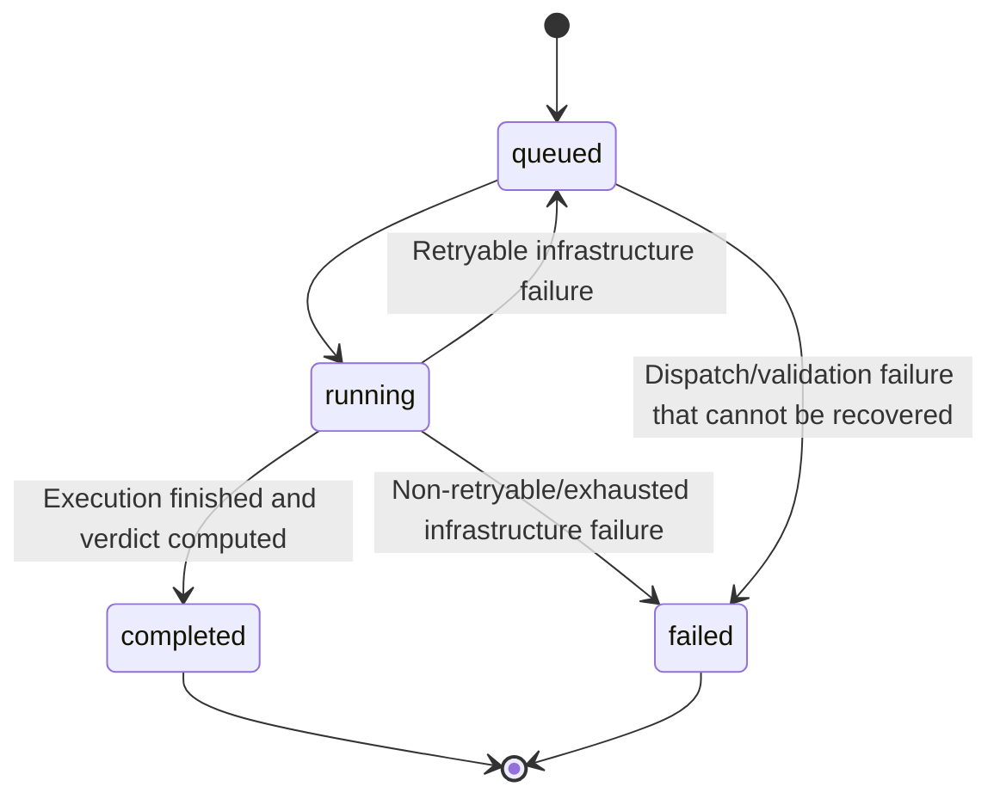

# M6 — Judge Microservice Architecture

**Status:** Draft v0.1 for review  
**Decision owner:** M6, with M1/M3 approval required for cross-service contracts  
**Scope:** Judge Service, execution queue, Docker isolation, technical integrity monitoring, and CI/CD

## 1. Context and requirements

LurnKode combines core LMS workflows with MCQ and programming assessment. The proposal specifies a separate Judge Worker and Docker Sandbox for learner-submitted code. The initial target limits in the proposal are 1 CPU, 128 MB RAM, and a 3-second execution timeout. Proposal verdicts include AC, WA, TLE, and RTE.

M6 must:

1. accept programming submissions from an authorized internal service;
2. persist a traceable submission record and enqueue execution asynchronously;
3. process jobs through a dedicated worker, not in the API request process;
4. execute Python and C++ code inside constrained Docker sandboxes;
5. keep hidden test inputs and expected outputs private;
6. persist execution results and deliver them to M3 with retry/idempotency handling;
7. record technical and operational events for later review;
8. provide local development, tests, and CI quality gates.

## 2. Status of architecture choices

| Item | Status | Decision in this draft |
|---|---|---|
| M6 service boundary | M6 proposal | Independently deployable service, potentially inside the team monorepo |
| Runtime/framework | User-selected direction | Bun + TypeScript + ElysiaJS; compatibility tested before lock-in |
| Queue | User-selected direction | BullMQ + Redis |
| Languages | User-selected direction | Python and C++, separate runner images |
| Sandbox | Proposal baseline + M6 proposal | Docker containers with explicit hardening and per-execution cleanup |
| Result delivery | M6 proposal | Internal REST callback from M6 to M3, with durable retry and idempotency |
| Database | Proposal baseline | PostgreSQL + Drizzle ORM; shared PostgreSQL infrastructure may be used, but table ownership remains service-specific |
| Integrity monitoring | Draft | Technical/security/operational events only initially; no automatic misconduct finding |
| CI | User-selected direction | GitHub Actions |
| Local deployment | User-selected direction | Docker Compose for local development/demo |
| Transactional outbox | Recommended design | Use an outbox/reconciliation mechanism to avoid database/queue dual-write loss; implementation complexity to be confirmed |

## 3. High-level architecture



The diagram shows the target design, not existing implementation. The callback route and M1 event endpoint are proposed names only and need confirmation from their owners.

### 3.1 Process and container boundaries

- `judge-api`: validates requests, authorizes service callers, writes submission state, and returns quickly. It does not compile or execute submitted code.
- `judge-worker`: consumes BullMQ jobs, loads the stored payload snapshot, provisions the sandbox, collects results, persists the result, and triggers result/event delivery.
- `redis`: stores queue state and job metadata. Job payloads contain identifiers only, not source code or hidden tests.
- `postgres`: stores M6-owned submission/result/payload/event/outbox data. M3 remains the system of record for assessment definitions, attempts, and final grading rules.
- `python-runner` and `cpp-runner`: pinned, prebuilt execution images. Learner code is not allowed to choose its own image, command, network, mount, or runtime flags.
- Docker daemon access is available only to the trusted M6 worker. Never mount the Docker socket into a learner sandbox.

For the MVP, API and worker may use one codebase but must run as separate processes/containers so they can have independent lifecycles and resource settings. This does not require two independently versioned repositories.

## 4. Submission lifecycle



## 5. Queue and delivery reliability

BullMQ's documented delivery model can process a job more than once in certain failure situations. Therefore, M6 must treat job execution and callback delivery as at-least-once, with idempotent state transitions and consumers. A stable job ID and a database uniqueness/state guard reduce duplicate side effects but do not make arbitrary container execution exactly-once.

### Proposed safeguards

- Persist the submission and an enqueue-outbox record in one PostgreSQL transaction.
- Dispatch pending outbox rows to BullMQ using a deterministic job ID derived from the M6 submission ID.
- The worker atomically checks/claims the submission state. If the submission already reached a final state, it must not create a second final result.
- Persist the result and a result-callback outbox event in one transaction.
- Retry callback delivery using the same `eventId`; M3 must be idempotent on that identifier or the submission/revision pair.
- Record terminal queue/dispatch failures and expose them to operations; do not silently drop events.
- Define a reconciliation task that detects submissions stuck in non-terminal states and outbox rows that remain pending too long.

**Implementation note:** the outbox pattern is the recommended reliability design. If the team wants a smaller first PoC, it may first test direct enqueue plus reconciliation, but the final architecture must explicitly handle the PostgreSQL/Redis dual-write failure window.

## 6. Data ownership

A shared PostgreSQL instance is acceptable for the MVP; shared ownership of tables is not recommended.

| Data | System of record | M6 responsibilities |
|---|---|---|
| Assessments, assessment items, canonical test configuration | M3 | Receive an authorized immutable judge-package snapshot, or use a M3-approved package-reference mechanism |
| Learner attempts and final score | M3 | Never directly update M3 attempt/score tables |
| M6 submission identity and lifecycle | M6 | Create and own `judge_submissions` |
| Submitted source and immutable execution-package snapshot | M6 temporary/retained execution data | Restrict access, exclude from logs, enforce a retention policy |
| Execution verdict/runtime/test summary | M6 execution record; consumed by M3 | Persist before callback; send a versioned result event |
| Technical integrity/operational events generated by M6 | M6 source event; central review may belong to M1/Admin | Store and deliver events; do not automatically declare misconduct |
| Audit review status | Proposed M1/Admin ownership | M6 supplies evidence/event only; confirm with M1 |

Avoid cross-service foreign keys from M6 tables into M3-owned tables. Store external identifiers as references and validate them at the API boundary.

### Suggested M6-owned tables (conceptual, not a committed schema)

- `judge_submissions`: IDs, producer IDs, language, status, revision, timestamps, trace ID, attempt count.
- `judge_payload_snapshots`: source code plus immutable judge package/test snapshot; access restricted and retention-controlled.
- `judge_results`: verdict, safe summary, runtime/memory metadata, terminal failure code where relevant.
- `judge_outbox`: pending queue and callback/event deliveries.
- `judge_events`: technical/integrity event records with allowlisted metadata.
- `judge_delivery_attempts` (optional): destination category, timestamps, response class, attempt number; never store credentials.

Naming and exact schema remain open until the group adopts repository naming conventions.

## 7. Execution contract and verdict semantics

### Proposed job payload stored in BullMQ

```json
{
  "schemaVersion": "1.0",
  "judgeSubmissionId": "<uuid>",
  "traceId": "<uuid>"
}
```

Do not place source code, hidden test input, or expected output in the queue payload. The worker loads the private snapshot from the M6 store.

### Proposed business state machine



`completed` means the judge was able to finish judging; it does not imply an accepted solution. A completed result can be `WA`, `TLE`, `RTE`, or another agreed verdict. Infrastructure failure is represented separately and must not be mapped to `WA`.

### Verdict draft

- Proposal baseline: `AC`, `WA`, `TLE`, `RTE`.
- M6 recommends adding `CE` for C++ compilation failure; M3 must approve this.
- Memory-limit outcome is unresolved: decide whether to add `MLE` or map it to an agreed runtime-failure verdict while preserving a `memory_limit_exceeded` technical event.
- Queue, Redis, daemon, or worker infrastructure failure is **not** a learner verdict. It uses `executionStatus = failed` with a machine-readable failure code.

### Resource limits

Proposal baseline for execution: 1 CPU, 128 MB RAM, 3,000 ms. M6 must enforce hard server-side ceilings even if request payloads include requested limits. C++ compilation can require different CPU/memory/time settings than execution; compile limits are TBD and must be measured separately in PoC. Do not silently change the proposal's runtime limit.

## 8. Docker sandbox security baseline

The following is a proposed minimum, subject to PoC and a threat-model review:

- Each execution uses a temporary sandbox/container; cleanup occurs on every terminal path, including timeout and worker errors.
- Run as a non-root user; do not use `--privileged`.
- Drop unnecessary Linux capabilities; use `no-new-privileges` and the default/approved seccomp profile.
- Disable network access for learner code unless an assessment explicitly requires it (MVP default: no network).
- Set explicit CPU, memory, PID, execution-time, and output-size limits.
- Use a read-only root filesystem where feasible and bounded temporary writable storage.
- Do not mount host home directories, project workspace, secrets, database credentials, or the Docker socket into the sandbox.
- Only trusted worker code controls the Docker API. Learner-controlled values must never be interpolated into shell commands; use argument arrays and strict validation.
- Keep expected outputs and test metadata outside the learner-visible process; never return hidden inputs/expected outputs through API or logs.
- Pin runner base images and language/compiler versions when implementation starts; define an update process for security fixes.
- Log safe metadata and trace IDs; never log full source code, hidden tests, tokens, or environment secrets.

Docker containers share the host kernel. Docker hardening is the MVP baseline, not a claim of strong VM-grade isolation against every possible kernel escape. If the threat model includes hostile public users and production-grade adversaries, consider running workers on dedicated/ephemeral hosts or evaluating a stronger sandbox runtime in a separate ADR.

## 9. Integrity monitoring policy

Initial scope should be technical/security/operational monitoring, not automated academic-misconduct detection.

Examples: timeout enforcement, memory limit exceeded, container cleanup failure, unexpected sandbox configuration, worker crash, repeated retry exhaustion, and callback delivery failure.

An event indicates an observation requiring review; it is not proof that a learner cheated. Avoid labels such as `cheater` or `violation_confirmed` in the M6 contract. Central review status and instructor/admin workflows need M1/Instructor confirmation.

## 10. Local deployment and CI/CD

### Local

Use Docker Compose for Redis, M6 API, M6 worker, and the application environment needed by M6. PostgreSQL may point at the group's approved shared development database or a local container depending on the root repo setup. Avoid creating a second conflicting Compose stack before reviewing team conventions.

### CI target

GitHub Actions should initially run:

1. checkout and setup the pinned Bun version;
2. install dependencies from the committed lockfile;
3. lint and typecheck;
4. unit tests;
5. Redis-backed queue integration tests;
6. build/check M6 API and worker;
7. build Python/C++ runner images;
8. Linux Docker sandbox smoke/security tests where the runner supports Docker;
9. minimum-permission workflow configuration and no secrets for untrusted fork PRs.

CI is in MVP scope. CD to a server is out of scope until a deployment target and secret-management model are approved.

## 11. PoC acceptance gates

### Queue PoC

- Bun + BullMQ + selected Redis client adapter can enqueue and consume jobs in the chosen pinned versions.
- Graceful close/restart and Redis reconnect behave as documented.
- Worker kill/stalled job behavior is understood and tested.
- Duplicate/replayed jobs do not create duplicate final records or callbacks.
- Queue payload contains only IDs/trace metadata.

### Sandbox PoC

- Python and C++ test programs produce correct AC/WA/TLE/RTE outcomes.
- C++ compile failure semantics are agreed and tested.
- CPU/RAM/time/PID/output limits are demonstrated, not just configured.
- Network access and host-file access are blocked as expected.
- All containers and descendant processes are cleaned up after success, timeout, and crash.
- Compile limits are measured independently from runtime limits.

### Cross-service PoC

- M3 receives a result callback and can safely receive the same event twice.
- Temporary callback failure is retried without losing the result.
- M1 can ingest technical events with trace/submission IDs after its event endpoint is agreed.

## 12. External references

These references inform the proposed reliability/security controls; they do not mean the listed features are already implemented.

- BullMQ Workers and stalled jobs: https://docs.bullmq.io/guide/workers
- BullMQ retries: https://docs.bullmq.io/guide/retrying-failing-jobs
- BullMQ at-least-once behavior notes: https://docs.bullmq.io/bull/important-notes
- BullMQ connections / Bun adapter example: https://github.com/taskforcesh/bullmq/blob/master/docs/gitbook/guide/connections.md
- Docker resource constraints: https://docs.docker.com/engine/containers/resource_constraints/
- Docker Engine security: https://docs.docker.com/engine/security/
- GitHub Actions workflow syntax and token permissions: https://docs.github.com/en/actions/reference/workflows-and-actions/workflow-syntax
- GitHub Actions secure use: https://docs.github.com/en/actions/reference/security/secure-use

External references checked: 2026-10-11.
